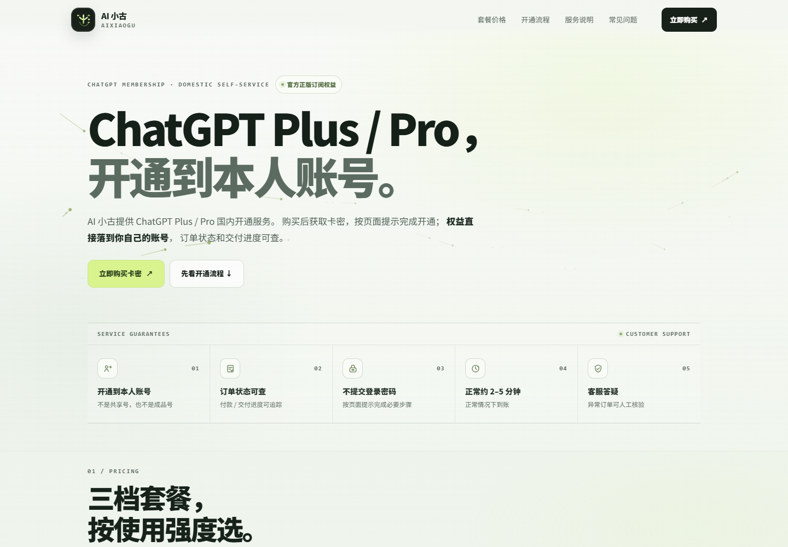

# 【亲测可用】支付宝/微信充值 ChatGPT Plus/Pro｜国内购买与开通指南

开通的是本人 ChatGPT 账号内的官方 Plus / Pro 会员权益。小古 GPT 提供支付宝、微信付款及自助开通服务；小古 GPT 与 OpenAI 不存在授权或合作关系。套餐、价格、操作说明与售后规则以实时购买页和订单信息为准。

ChatGPT Plus / Pro 怎么充值、怎么买会员？国内用户常见的选择有三种：第三方代充（小古 GPT 自助开通）、Google Play 绑卡订阅、App Store 礼品卡（Apple 礼品卡）订阅。下面整理每种方式的步骤、优缺点和操作难点，按自己的设备与付款条件选择即可。价格、套餐和可用性以账号实际页面为准。

## 你要找什么

| 你正在搜索 | 直接看这里 |
| --- | --- |
| ChatGPT Plus 怎么充值、国内怎么购买 | [购买与充值指南](docs/chatgpt-plus-purchase.md) |
| ChatGPT Plus 会员价格、订阅费用 | [价格、额度与免费试用说明](docs/chatgpt-plus-price-quota-trial.md) |
| ChatGPT Plus 额度是多少、会不会用完 | [价格、额度与免费试用说明](docs/chatgpt-plus-price-quota-trial.md) |
| ChatGPT Plus 免费一个月、免费试用 | [价格、额度与免费试用说明](docs/chatgpt-plus-price-quota-trial.md) |
| 付款后没显示 Plus、怎么查订单 | [充值常见问题](docs/faq.md) |
| Google Play 绑卡失败、扣款后 Plus 没显示 | [购买与充值指南](docs/chatgpt-plus-purchase.md) |
| App Store 礼品卡 / Apple 礼品卡兑换、余额不足或订阅未到账 | [购买与充值指南](docs/chatgpt-plus-purchase.md) |
| 续费、取消订阅、Plus 和 API 的区别 | [完整 FAQ](docs/faq.md) |

## ChatGPT Plus / Pro 三种充值方式

| 方式 | 适合人群 | 操作与账号 | 价格及额外成本 | 主要取舍 |
| --- | --- | --- | --- | --- |
| 第三方代充（小古 GPT） | 有自己的 ChatGPT 账号；没有海外卡、想用支付宝/微信或有企业采购需求的人 | 操作难度低；目标为本人账号；按页面说明操作 | 购买页人民币套餐价；续费需再次购买 | 综合较省心；但属第三方服务，需核对隐私与售后规则，不能当作 OpenAI 官网直付 |
| Google Play 绑卡 | 熟悉海外支付、有 Android / Google Play 和可用银行卡或虚拟卡的人 | 操作难度高；ChatGPT 账号与 Google 付款账号分开 | 会员费加可能的税费、汇兑费，以及虚拟卡开卡、充值、月费等 | 订阅和账单由 Google Play 管理；卡片及付款资料不一定适用。iPhone 不能通过 Google Play 订阅 |
| App Store 礼品卡 | 熟悉苹果生态、有自己的 ChatGPT 账号和 iPhone/iPad 的人 | 操作难度中；ChatGPT 账号与 Apple Account 分开 | 会员费加礼品卡溢价及潜在税费，也要考虑汇率、手续费和余额闲置 | 账单由 Apple 管理；Apple Account、商店和礼品卡地区需匹配 |

### 1. 第三方代充（综合较省心）

**步骤：** 查看[小古 GPT 购买页](https://xiaogugpt.top/)的套餐、价格和售后规则 → 选择套餐并按页面流程付款 → 按说明完成开通 → 登录自己的 ChatGPT 账号核对会员状态。

**优点：** 支持购买页当前展示的人民币付款方式，少处理海外卡和应用商店设置，操作步骤相对少。

**难点与缺点：** 需要判断服务规则和信息处理方式是否能接受；属于第三方服务，续费通常要重新购买。下单前确认失败退款、订单查询和售后入口；不要提供密码、验证码。

### 2. Google Play 绑卡（谨慎尝试）

**步骤：** 确认 Android 设备可使用 Google Play 和 ChatGPT App → 核对 Google 付款资料与银行卡适用性 → 在 ChatGPT App 查看是否提供 Google Play 订阅 → 核对结账金额后订阅 → 在 Google Play 查订单和续费。

**优点：** 付款、订单、续费和取消由 Google Play 管理。

**难点与缺点：** 需要 Android / Google Play，付款资料或银行卡可能不适用；虚拟卡还可能产生开卡、充值、汇兑或维护费用。iPhone 不能通过 Google Play 订阅 ChatGPT App；扣款后未到账，先查原订单，不要重复支付。

### 3. App Store 礼品卡（可以考虑）

**步骤：** 确认 App Store 中有可用的 ChatGPT 订阅方案 → 购买与本人 Apple Account 地区匹配的礼品卡 → 兑换并核对余额 → 在 ChatGPT App 订阅 → 在 Apple 订阅中查看续费和取消。

**优点：** 付款与订阅记录由 Apple 管理。

**难点与缺点：** Apple Account、商店和礼品卡地区要匹配；礼品卡可能有溢价，余额还需覆盖最终金额及可能税费，买多了会闲置。扣款后未到账，先核对 Apple 订单和 ChatGPT App 当前登录账号。

第三方代充的人民币价格、套餐周期和售后以购买页为准；Google Play 与 App Store 以各自最终结账页面为准。无论选哪种方式，都先确认权益开到自己的 ChatGPT 账号。

*截图于 2026-10-20 取自小古 GPT 网站公开首页，只用于展示网站当时的页面内容。页面上的服务说明、流程和时间为网站展示信息，本仓库未独立验证；请以实时页面和订单说明为准。*

更多购买注意事项见[购买与充值指南](docs/chatgpt-plus-purchase.md)。

这里的“充值”指开通或续订 ChatGPT 会员，不是给账户存入通用余额。ChatGPT 订阅与 OpenAI API 计费分开；价格、功能、额度和免费试用资格可能变化，以官方说明和本人结账页为准。不要向任何第三方提供账号密码、邮箱验证码或支付验证码。

下单前核对套餐、周期、总价和售后规则；不要向任何第三方提供密码或验证码。

**[查看小古 GPT 当前 ChatGPT Plus / Pro 套餐与开通说明 →](https://xiaogugpt.top/)**

## 企业采购与合作

**接受企业采购。** 如果你代表公司、团队或机构，需要批量采购或洽谈长期合作，请通过购买页展示的客服入口沟通需求、采购数量、采购流程和交付安排。企业采购是否涉及合同、发票或对公付款，请在采购前确认可提供范围和所需材料；以双方书面确认的方案与条款为准。

## 常见问题

### ChatGPT Plus 代充会导致封号吗？

正规渠道走官方支付通道、充官方正版订阅，风险很低。封号重灾区是共享拼车账号和来路不明的低价成品号。

### 代充会开到我自己的账号吗？聊天记录是私有的吗？

下单前确认开通到你本人长期使用的 ChatGPT 账号。第三方可能处理必要的账号标识或订单信息，不能承诺信息绝对私有；不要提供密码、验证码、Cookie、Session Token 或 API Key。卖家发来账号密码属于账号交付，不是给你的账号充值。

### ChatGPT Plus 会员价格是多少？

以自己实际看到的结账金额和购买页当时展示为准。

### ChatGPT Plus 有免费一个月吗？

不要默认每个账号都有免费一个月。若官方为你的账号展示试用或优惠，先确认资格、结束日期、自动续费金额和取消方式；页面未显示时，就不能把它当成可领取权益。

### ChatGPT Plus 的额度是多少？

额度会按模型或功能变化，也可能随产品调整。请看 ChatGPT 页面当前提示，不要把旧文章里的数字当成永久标准。

### 付款后没有显示 Plus 怎么办？

先核对购买时的 ChatGPT 账号、付款订单和订阅管理渠道。保存订单号及必要的脱敏信息，通过原付款渠道或购买页面的售后入口查询；没有确认第一笔状态前不要重复购买。

### 购买 Plus 会包含 API 额度吗？

不会。ChatGPT 订阅与 API 计费分别管理，购买前确认你需要的是会员订阅还是 API 用量。

## 官方资料

- [OpenAI 帮助中心：ChatGPT Plus 方案说明](https://help.openai.com/en/articles/6950777-what-is-chatgpt-plus)
- [OpenAI 帮助中心：取消 ChatGPT 订阅](https://help.openai.com/en/articles/7232927-canceling-your-chatgpt-subscription)

资料核对日期：2026-10-20。关于 Plus 方案与订阅管理，请参阅上方 OpenAI 帮助中心原文。本文为独立整理，不代表 OpenAI。ChatGPT、OpenAI 及相关名称归各自权利人所有。价格、套餐、模型、额度和试用政策可能变化，购买前请再次核对官方页面与实际订单说明。

## 你可能还在搜索

- **国内怎么购买或充值 ChatGPT Plus / Pro？** 查看[ChatGPT Plus / Pro 购买与充值指南](docs/chatgpt-plus-purchase.md)，比较第三方服务、Google Play 和 App Store 等方式。
- **没有海外信用卡，怎么开通 ChatGPT Plus？** 先看[购买与充值指南](docs/chatgpt-plus-purchase.md)中的方式对比，再按自己的设备和付款条件选择；第三方服务并非 OpenAI 官方直付。
- **支付宝或微信可以购买 ChatGPT Plus 吗？** 不同支付方式对应不同订阅渠道；第三方服务当前支持情况及规则以其购买页为准，选择前可阅读[第三方服务注意事项](docs/chatgpt-plus-purchase.md)。
- **ChatGPT Plus / Pro 价格多少，额度是多少，有免费试用吗？** 价格、额度和试用资格可能变化，请查看[价格、额度与免费试用说明](docs/chatgpt-plus-price-quota-trial.md)及本人页面的实际信息。
- **Google Play 扣款后没有显示 Plus，或 App Store 礼品卡怎么订阅？** 查看[购买与充值指南](docs/chatgpt-plus-purchase.md)中的应用商店步骤和付款核对方法。
- **ChatGPT Plus 付款后没到账、怎么续费或取消？** 参阅[充值与会员常见问题](docs/faq.md)，并先通过原付款渠道核对订单状态。
- **ChatGPT Plus 付款失败、信用卡被拒怎么办？** 先查看实际付款渠道给出的错误信息；若已经扣款，先查原订单，不要重复付款。可参考[购买与充值指南](docs/chatgpt-plus-purchase.md)核对订阅渠道和付款后处理步骤。
- **ChatGPT Plus 还没到期，可以升级到 Pro 吗？** 是否能升级、升级价格及剩余订阅如何处理，以本人账号当前显示的方案和结账页面为准；选择第三方服务时，先确认订单说明中的套餐、费用和有效期。
- **ChatGPT Plus 和 Pro 有什么区别，应该选哪个？** 方案权益、可用功能和使用限制可能变化，购买前请在本人账号当前方案页面比较功能、价格与周期；也可先读[购买与充值指南](docs/chatgpt-plus-purchase.md)了解不同购买方式及各自条件。
